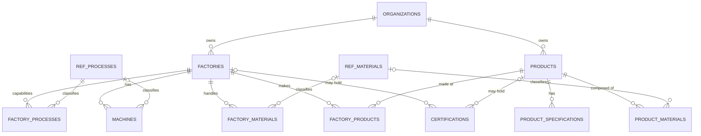

# M1.4B schema design: manufacturing capabilities and products

Status: **DRAFT, not applied** to any database. Migration: `supabase/migrations/20261022150000_capabilities_and_products.sql`. Builds on the six foundation tables. It changes **one policy only** (`factories_update_owner`, section 3a); no foundation table, column or grant is altered and the applied foundation migration file is not edited.

## 1. Tables (exactly 10)

| Table | Kind | Purpose | Delete model |
|---|---|---|---|
| `ref_processes` | global reference | Controlled vocabulary of manufacturing processes | none (staff-maintained) |
| `ref_materials` | global reference | Controlled vocabulary of polymers | none (staff-maintained) |
| `factory_processes` | tenant, link-style | A factory's capabilities, with optional declared capacity; or one factory-wide capacity row | owner hard delete, audited |
| `machines` | tenant, independent | Machinery and ratings | soft delete (`archived_at`) |
| `factory_materials` | tenant, link-style | Materials a factory can process | owner hard delete, audited |
| `products` | tenant, independent | Finished-product catalogue entry, packaging, claimed HS code | soft delete |
| `product_specifications` | tenant, link-style | Free-form specification rows | owner hard delete, audited |
| `product_materials` | tenant, link-style | Material composition of a product | owner hard delete, audited |
| `factory_products` | tenant, link-style | Which factory makes which product | owner hard delete, audited |
| `certifications` | tenant, independent | Certificate records and reported expiry | soft delete |

## 2. Isolation by construction

- Every tenant table has `organization_id uuid not null` (FK to `organizations`, `on delete restrict`).
- Every relationship to a factory or product is a **composite** foreign key `(organization_id, factory_id|product_id)` referencing `factories(organization_id, id)` / `products(organization_id, id)`. A row of company A can only ever point at a parent that belongs to company A, whatever the RLS policy says. `factories_org_id_key` already exists; `products_org_id_key` is added.
- **NULL behaviour** (`certifications`): the foreign keys use the default `MATCH SIMPLE`, so a NULL `factory_id` or `product_id` switches that check off. That is exactly "this certificate is not linked to a factory/product". When an id is present, the pair must exist.
- Reference tables are global and carry no tenant data.

## 3. Privileges and RLS

- `anon`: nothing. `authenticated`: explicit grants only. Defaults are revoked in the migration and per column.
- **Read:** members of the company and platform admins. **Write:** company owners (the foundation's `private.is_org_owner`). The existing helpers are reused; no new SECURITY DEFINER function is reachable from the API.
- **Column-level grants.** Insert-only: `organization_id`, `factory_id`, `product_id`, `scope`. Never client-writable: `created_by`, `source`, `hs_code_status`, `verification_status`, `verified_by`, `verified_at`, and (on tables where it is not listed) `archived_at`.
- Independent records (`machines`, `products`, `certifications`): no DELETE privilege; the UPDATE policy requires `archived_at is null` on the existing row, so an archived record can neither be edited nor restored through the API.
- Link-style rows: owners may DELETE; every deletion is audited.
- Reference tables: SELECT only for `authenticated`; no write privilege exists.

### 3a. Foundation correction: archived factories are frozen

The foundation policy `factories_update_owner` allowed an owner to update any factory of their company, including an archived one (edit it or set `archived_at` back to NULL). That contradicts the rule this migration enforces for dependents. The migration therefore runs `ALTER POLICY factories_update_owner ... USING (owner and archived_at is null) WITH CHECK (owner)`:

| Action by an owner through the API | Result |
|---|---|
| Archive an **active** factory | allowed |
| Edit an **active** factory | allowed |
| Edit an **archived** factory | no row is visible to the UPDATE: nothing changes |
| Restore an **archived** factory (`archived_at = NULL`) | no row visible: nothing changes |
| Archive an already archived factory | no row visible: no-op |
| Register a replacement factory (same name allowed once the old one is archived) | unaffected (INSERT policy plus the partial unique index on active names) |

Restoring an archived factory is an administrator action (SQL, audited). The administrator path is itself guarded: restoring is refused if an active factory has since taken the name (unique index). The existing application already filters both its edit and archive queries to active rows, so factory registration and management behave exactly as before.

## 4. Audit

All eight tenant tables use the existing `private.audit_row_change()` (insert, update, delete): actor, company, entity, and **column names only**, never values. Link removals are therefore recorded. The function already derives the company from `organization_id` and the entity from `id`, so no change to it was needed (checked by running it against every new table).

## 5. Measurements

- **Capacity** (`factory_processes`): `capacity_quantity numeric(14,3) > 0` + `capacity_unit` in (`kg`, `tonnes`, `pieces`, `metres`, `m2`) + `capacity_period` in (`day`, `month`, `year`), all three present or all absent, plus optional `as_of` date.
- **Factory-wide vs process-specific:** `scope = 'process'` rows name exactly one process (reference or custom) and may carry capacity. `scope = 'factory_wide'` rows name no process, must state a capacity, and there is at most one per factory.
- **Machine rating:** `rating_value > 0` + `rating_unit` in (`tonnes_clamp_force`, `g_shot_weight`, `kg_per_hour`, `pieces_per_hour`, `mm_screw_diameter`), both or neither.
- **Product packaging:** stored in one canonical unit per quantity, named in the column: `unit_weight_g` (grams), `carton_gross_weight_kg` (kilograms), `carton_length_mm` / `carton_width_mm` / `carton_height_mm` (millimetres), `units_per_carton`. All positive; the three dimensions are all-or-none. The application converts (for example kg to g) at the edge. This keeps one unit per column so no later calculation can mix units.
- **Composition:** `share_percent` in (0, 100]; the shares of one product cannot total more than 100 (trigger; the product row is locked `FOR NO KEY UPDATE` to serialize concurrent edits; refused under REPEATABLE READ).

## 6. Products, HS codes and certifications

- `hs_code_claimed` accepts only digit forms of 4, 6, 8 or 10 digits (dots optional). `hs_code_status` is fixed to `'unverified'` by a CHECK and is not client-writable. Nothing infers a classification or eligibility from it; a later migration relaxes the CHECK when a review workflow exists.
- Certificates: `expires_on` is the date **reported** from the certificate and is informational only. `verification_status` (`unverified` default, `verified`, `rejected`) is a separate fact and is never client-writable; `verified` requires `verified_at` (CHECK). Regulatory acceptance is not modelled: a certificate is a record, never a finding of compliance.
- Scope of a certificate: company-level (no links), factory-level, product-level, or product-at-factory. Links are insert-only.
- `source` (`user_provided` default, `ai_assisted` for future accepted AI suggestions) is not client-writable.

## 7. Archive behaviour (documented and enforced)

| Event | What happens |
|---|---|
| **A factory is archived** (existing app behaviour, sets `archived_at`) | Nothing cascades. Its machines, capabilities, materials, links and certificates remain, readable. They are **frozen**: the API can no longer insert, edit or delete rows that point at that factory (`private.enforce_active_parents`, error `55000`). The factory's name becomes reusable. Restoring a factory is an administrator action. |
| **A product is archived** | Same: nothing cascades; its specifications, composition, links and certificates stay readable and become frozen; no new ones can be attached. Name and internal code become reusable. It cannot be restored through the API. |
| **An active product is linked to an archived factory** | The link row stays as history and remains readable. It cannot be removed through the API (frozen). The product itself stays fully active and can be linked to other active factories. New links to the archived factory are refused. Features that count "where this is made" should count only links to active factories. |
| **A certificate reaches its reported expiry date** | Nothing changes in the data: no automatic archive, status change or notification trigger exists. "Valid / expiring soon / expired" is computed at read time from `expires_on` (thresholds belong to the application), and is separate from `verification_status`. |

Independent records are never hard-deleted. The two trigger functions add the freezing and the composition check (concurrency analysis in `docs/m1.4b-security-review.md` section E); both are SECURITY DEFINER, `search_path = ''`, in schema `private`, with no EXECUTE grants.

## 8. Reference data (starter lists, for review)

**Processes (9):** Injection moulding, Blow moulding, Extrusion, Thermoforming, Rotational moulding, Compression moulding, Additive manufacturing, Printing, Finishing.

**Materials (14), with a descriptive `family` label that carries no regulatory meaning:** PP (polyolefin), HDPE (polyolefin), LDPE (polyolefin), LLDPE (polyolefin), PET (polyester), PVC (vinyl), PS (styrenic), HIPS (styrenic), ABS (styrenic), PC (engineering), PA (engineering), PMMA (acrylic), TPE (thermoplastic elastomer), TPU (thermoplastic elastomer).

Review notes: the lists are exactly the approved starter lists. Names are neutral descriptions, not compliance statements. Custom entries cover anything else: `custom_name` on capabilities and materials, free text on specifications. Manufacturers cannot modify these tables (no write privilege); staff maintain them with SQL and `is_active` retires an entry without breaking existing links. The seed insert is idempotent (`on conflict (code) do nothing`).

## 9. Unresolved design decisions

1. **Canonical units in column names** (`_g`, `_kg`, `_mm`) versus value + unit columns for packaging. Chosen for consistency; confirm.
2. **Factory-wide capacity is a row in `factory_processes`** (`scope = 'factory_wide'`) to stay within the approved 10 tables. A separate table would be cleaner but is an 11th table. Confirm.
3. **Frozen children of archived parents** (including no removal of links to an archived factory). Chosen to preserve history; the alternative is to let owners tidy links. Confirm.
4. **Archived independent records cannot be restored via the API.** Restoration is an audited administrator action. Confirm, or add an owner "restore" action later.
5. **Composition cap** (sum of shares at most 100) is enforced by a trigger. Keep, or leave to the application?
6. **Certificate uniqueness** on (company, issuer, certificate number) among active certificates. Keep, or allow duplicates?
7. **Machine rating units** (five) and **certificate kinds** (five) are fixed lists; extending them needs a migration.
8. **HS code shape** limited to 4/6/8/10 digits; national tariff lines longer than that are out of scope for now.
9. **service_role** keeps Supabase's default full access to the new tables (the app never uses it); the foundation only restricted it on `audit_log`. Restrict further, or accept?
10. **Policy change on an existing table** (section 3a): approve tightening `factories_update_owner` in this migration, as requested. Owners lose the ability to restore archived factories through the API (the app never offered it).
